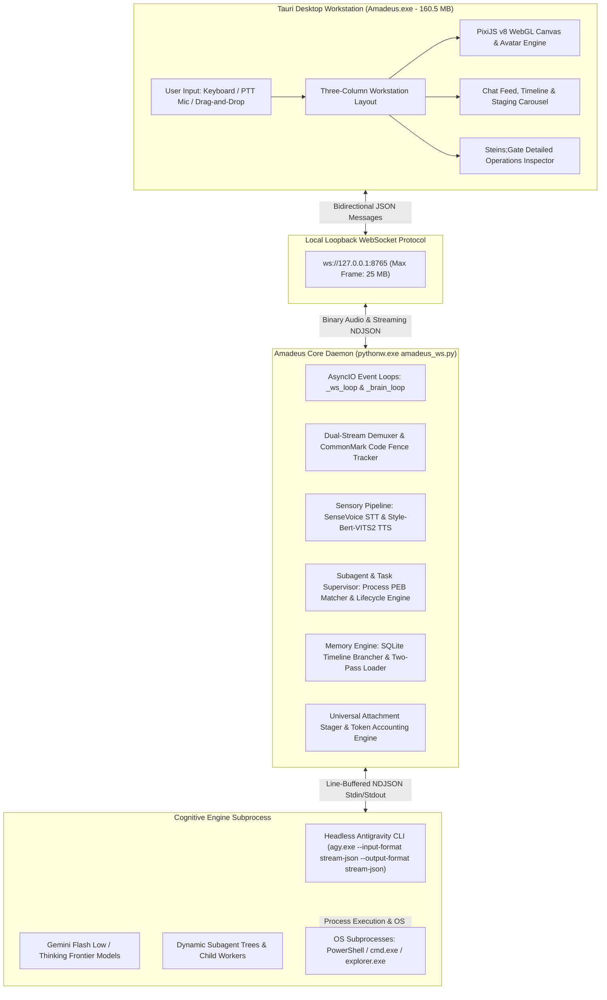

# Project Amadeus: Architecture & Engineering Specification (v0.1 Foundation)

**Target Platform:** Windows 11 (x86_64, Build 22000+)  
**Local Runtime Environments:** Python 3.11+ (`.venv`) & Rust 1.78+ / Tauri v2  
**Target Persona:** Makise Kurisu Digital Consciousness Replica (*Steins;Gate* / *Steins;Gate 0*)  
**Document Purpose:** Master Developer Specification & Engineering Manual for Core Contributors, Compiler Hackers, and AI Systems Engineers  

---

## 1. Document Overview & System Purpose

Project Amadeus is an engineering-grade, local-first artificial intelligence workstation and companion designed to run completely on consumer-grade Windows 11 hardware. Grounded in the lore of *Steins;Gate 0*, Amadeus implements an autonomous digital consciousness replica of neuroscientist Makise Kurisu. 

Unlike conventional chatbot wrappers or web-based agent frontends, Project Amadeus operates as a decoupled, multi-process desktop system combining:
1. A hardware-accelerated **Rust / Tauri v2** visual novel workstation shell embedding 183 high-resolution Makise Kurisu 2D sprites, real-time WebGL canvas telemetry, and 60 FPS audio-driven viseme lip-flapping.
2. A high-performance local **Python 3.11+ Core Daemon** hosting on-device neural speech recognition (FunASR SenseVoice-Small), a dual-language 44.1 kHz neural speech synthesis engine (fine-tuned Style-Bert-VITS2), and an anti-metallic audio DSP filter pipeline.
3. A headless, line-buffered NDJSON subprocess bridge into the **Google Antigravity CLI (`agy.exe`)**, granting Amadeus full autonomous tool execution authority across filesystem operations, terminal commands, web retrieval, and dynamic subagent task trees.

This specification serves as the comprehensive reference manual for the v0.1 Foundation release. It details every architectural layer, communication contract, process lifecycle boundary, mathematical formulation, and persistence invariant governing the system.

---

## 2. System Topology & Communication Protocol

The architecture of Project Amadeus is strictly split into two persistent local processes communicating over a high-throughput, loopback WebSocket bridge.



### 2.1 Process Separation & Specifications

| Component | Binary / Runtime | Memory Footprint | Role & Boundary |
| :--- | :--- | :--- | :--- |
| **Desktop Workstation** | `Amadeus.exe` (Rust / Tauri v2 / WebView2) | ~140 MB RAM | Bundles the complete frontend UI, WebGL backdrop, 183 visual novel sprites, and audio visualizer. Zero direct LLM access; communicates strictly via WebSocket. |
| **Core Daemon** | `pythonw.exe` (`.venv`, Python 3.11+) | ~900 MB (CPU) / ~2.4 GB (CUDA) | Coordinates audio DSP, neural models, persistence, Win32 API hooks, and supervisor authority. Runs windowless in the background. |
| **Cognitive Engine** | `agy.exe` (Antigravity CLI Subprocess) | ~80–120 MB RAM | Dispatched by the daemon with `--input-format stream-json --output-format stream-json`. Executes autonomous workflows and manages model context. |

### 2.2 Local WebSocket Protocol (`ws://127.0.0.1:8765`)

Communication between the Tauri desktop frontend and the Python backend occurs over a loopback WebSocket bound exclusively to `127.0.0.1:8765`. 
* **Payload Ceiling:** Frame limit is explicitly initialized to **25 MB** (`max_size=25 * 1024 * 1024`) via `websockets.serve`, accommodating full-resolution base64-encoded image attachments, multi-page PDF documents, and detailed subagent execution trees.
* **Message Format:** Bidirectional UTF-8 JSON payloads with a top-level `"type"` discriminator (e.g., `user_chat`, `token`, `viseme`, `loading_progress`, `subagent_info`, `task_log`).

### 2.3 Process Lifecycle & Stealth Execution

Amadeus incorporates zero-console stealth execution invariants to prevent flashing terminal boxes or intrusive console popups during tool dispatch or startup:

1. **Stealth VBScript Launcher (`Amadeus.vbs`):**
   ```vbscript
   Set WshShell = CreateObject("WScript.Shell")
   Set fso = CreateObject("Scripting.FileSystemObject")
   strPath = fso.GetParentFolderName(WScript.ScriptFullName)

   ' 1. Launch Python backend daemon headlessly using pythonw.exe (0 = hidden window)
   pythonwExe = strPath & "\.venv\Scripts\pythonw.exe"
   wsScript = strPath & "\Codebase\amadeus_ws.py"
   WshShell.Run chr(34) & pythonwExe & chr(34) & " " & chr(34) & wsScript & chr(34), 0, False

   ' 2. Brief wait for WebSocket server to bind port 8765
   WScript.Sleep 1500

   ' 3. Launch Tauri Desktop Client (standalone Amadeus.exe)
   releaseExe = strPath & "\Amadeus.exe"
   WshShell.Run chr(34) & releaseExe & chr(34), 1, False
   ```
2. **Global `CREATE_NO_WINDOW (0x08000000)` Silencer:**
   In `amadeus_ws.py`, `subprocess.Popen.__init__` is monkey-patched at the root module level on Windows:
   ```python
   if sys.platform == "win32":
       _orig_popen_init = subprocess.Popen.__init__
       def _silent_popen_init(self, *args, **kwargs):
           kwargs["creationflags"] = kwargs.get("creationflags", 0) | subprocess.CREATE_NO_WINDOW
           return _orig_popen_init(self, *args, **kwargs)
       subprocess.Popen.__init__ = _silent_popen_init
   ```
   This globally suppresses console window generation across all sub-processes: `agy.exe`, `taskkill.exe`, `explorer.exe`, and ad-hoc shell commands.
3. **Headless Logging Safeguard:**
   When running via `pythonw.exe`, standard streams (`sys.stdout`, `sys.stderr`, `sys.stdin`) evaluate to `None`. Any library writing directly to `sys.stdout` (e.g. `loguru` inside Style-Bert-VITS2) will throw fatal `TypeError` exceptions. The daemon redirects unallocated streams immediately:
   ```python
   if sys.stdout is None:
       _log_dir = Path(os.environ.get("LOCALAPPDATA", Path.home() / "AppData" / "Local")) / "ProjectAmadeus" / "logs"
       _log_dir.mkdir(parents=True, exist_ok=True)
       sys.stdout = open(_log_dir / "amadeus_ws.log", "a", encoding="utf-8", buffering=1)
   if sys.stderr is None:
       sys.stderr = sys.stdout if sys.stdout is not None else open(os.devnull, "w", encoding="utf-8")
   ```
4. **Clean Disconnect Watchdog & Handshake Failsafe:**
   * **3.0s Client Disconnect Watchdog:** When the Tauri client closes, `_handler` registers `len(_clients) == 0`. It starts a 3.0-second cancellation timer (`_graceful_shutdown`). If no client reconnects within 3 seconds, `_terminate_daemon_cleanly()` tears down child processes and exits.
   * **120s Startup Handshake Failsafe:** An initial connection timer terminates the daemon if no desktop client handshakes within 120 seconds of process creation, eliminating orphaned background processes.
5. **Sleep & Wake Recovery:**
   Hooks Windows power broadcasts:
   * `PBT_APMRESUMEAUTOMATIC`: Re-initializes audio capture streams and default audio output devices upon system wake.
   * `PBT_APMSUSPEND`: Synchronously flushes in-memory SQLite buffers to disk prior to system sleep.

---

## 3. 1-Click Universal Bootstrap Installer (`install.bat` + `install.py`)

Project Amadeus provides a turnkey, 1-click bootstrap installation pipeline that prepares the host machine, configures isolated virtual runtimes, resolves hardware topologies, and deploys weights without user intervention.

### 3.1 Preflight Environment Verification

The bootstrap process begins via `install.bat`, which evaluates the host system before dispatching `install.py`:
1. **Python Discovery & Side-by-Side Installation:** Probes `py -3.10` / `py -3.11`, standard `%LOCALAPPDATA%\Programs\Python`, and system PATH. If Python is absent, it silently deploys Python 3.10 side-by-side using `winget` or direct TLS 1.2 download from `python.org` without modifying existing global Python runtimes.
2. **Virtual Environment Isolation:** Builds an isolated `.venv` at the project root and enforces modern `pip>=24.0` via `ensurepip` to defuse wheel normalization errors.
3. **Antigravity CLI Verification & Version Locking:** Verifies `agy` is present on PATH and executes `agy models` (15s timeout) to ensure an active session is authenticated. Project Amadeus is validated on `Google.AntigravityCLI` version **1.2.15** (`winget install Google.AntigravityCLI --version 1.2.15` or with `--force` to downgrade). To prevent silent breakage from upstream CLI changes, auto-updates should be disabled (`$env:AGY_CLI_DISABLE_AUTO_UPDATE="1"`), and any lingering `update.lock` files in `.gemini/antigravity-cli/` must be removed.

### 3.2 Dynamic Hardware Profiling & PyTorch Wheel Resolution

Installing CUDA-accelerated machine learning packages through standard PyPI commands often results in silent downgrades to CPU wheels when subsequent packages are resolved. Amadeus eliminates this via physical pre-probing in `install.py` and `hardware_detector.py`:

```
               [ Step 2: Physical Hardware Probing ]
                                 │
           ┌─────────────────────┴─────────────────────┐
           ▼                                           ▼
 [ NVIDIA GPU Detected ]                     [ No Qualifying GPU ]
 (VRAM >= 3.75 GB via nvidia-smi)            (Intel / AMD / Integrated)
           │                                           │
           ▼                                           ▼
[ Install PyTorch 2.5.1 + cu121 ]           [ Install PyTorch 2.5.1 + CPU ]
(--index-url: .../whl/cu121)                (--index-url: .../whl/cpu)
           │                                           │
           ▼                                           ▼
[ Lock: ja_only = False ]                   [ Lock: ja_only = True ]
(Dual Engine: JA + EN Loaded)               (RAM Saved: ~1.5 GB | Optimized for CPU)
           │                                           │
           ▼                                           ▼
[ Download Full Model Pack ]                [ Skip English Model Download ]
(JA + EN Checkpoints + STT)                 (JA + STT Only | Save ~500 MB)
```

1. **Hardware Inspection:** Probes the Win32 registry and `nvidia-smi` prior to importing PyTorch. Evaluates total VRAM; systems with $\ge 3.75\text{ GB}$ dedicated VRAM qualify for CUDA Tensor Core mode.
2. **Isolated PyTorch Wheel Indexing:** PyTorch 2.5.1 is explicitly installed *first* with its dedicated index URL (`https://download.pytorch.org/whl/cu121` or `https://download.pytorch.org/whl/cpu`) before `requirements.txt` is evaluated. When `requirements.txt` runs, the same index URL is passed as `--extra-index-url`, preventing pip from downgrading torch.

### 3.3 CPU Mode Optimization & RAM Lockdown (`lock_hardware_config()`)

On CPU-bound installations, memory bandwidth and compute limitations demand architectural specialization:
* `lock_hardware_config()` automatically sets `"ja_only": True` in `models/hardware_config.json`.
* **RAM Lockdown:** By bypassing English DeBERTa-v3-large tokenizers and acoustic models on CPU machines, resident RAM usage drops from **~2.4 GB down to ~900 MB** (saving ~1.5 GB memory).
* **CPU Performance Optimization:** Restricting spoken synthesis to Japanese avoids loading the heavy English DeBERTa model, keeping speech generation lightweight and responsive on CPU without stalling the system.
* **Full Text Fidelity:** Full English text chat, English UI subtitles, and bilingual markdown rendering remain 100% active; only spoken acoustic synthesis is restricted to Japanese.

> [!NOTE]
> **A Note on Latency:** Voice synthesis latency on CPUs will naturally be a bit slower than on GPUs, though depending on your CPU, the latency might not be that bad. For reference, on my hardware (Intel Core i5-12450H), voice synthesis latency was around **1.0 to 1.2s per sentence**, whereas on my GPU (NVIDIA RTX 3050 Laptop GPU - 4 GB VRAM), it is virtually instantaneous (a few hundred milliseconds). Performance on other systems will vary depending on your specific hardware.

### 3.4 Selective Model Synchronization (`download_voice_models()`)

Voice assets are synchronized directly from Hugging Face ([`sehaj-notfound/amadeus-kurisu-voice`](https://huggingface.co/sehaj-notfound/amadeus-kurisu-voice)):
* `japanese/Kurisu_e63_s37500.safetensors`, `config.json`, `style_vectors.npy`
* `sensevoice/model.int8.onnx` (~239 MB), `tokens.txt`
* On CUDA systems: downloads `english/Kurisu_EN_e103_s21000.safetensors` (~500 MB), `config.json`, `style_vectors.npy`.
* On CPU systems: skips the English model download entirely, saving bandwidth and disk space.
* Temporary download caches (`for-hf-cache/`) are unlinked immediately after verification to prevent disk bloating.

---

## 4. Intelligence, Orchestration & Persona Engine

### 4.1 Cognitive Engine Orchestration

Amadeus coordinates with Google Antigravity CLI as its primary cognitive backbone (Engine A):
* **Invocation Mode:** Line-buffered NDJSON stream (`agy.exe --input-format stream-json --output-format stream-json`).
* **Dynamic Model Policy:** Rather than locking to a static model name, Amadeus dynamically queries `agy models` via `query_agy_models()` on startup. It resolves to the latest available Flash model at low thinking (e.g. `gemini-*-flash-low`) as default for fast conversational responsiveness, while allowing users to switch models mid-flight via the UI dropdown.
* **Session Continuity:** Model switches execute `AmadeusBrain.switch_model()` using `--conversation <active_id>`, preserving all preceding context, scratchpads, and file attachments.

### 4.2 Solitary Persona Specification (`workspace/GEMINI.md`)

The Makise Kurisu persona is governed strictly by `workspace/GEMINI.md`, which is mirrored into `%LOCALAPPDATA%\ProjectAmadeus\profile\.gemini\GEMINI.md`:
* **Yakuwarigo & Linguistic Profile:** Kurisu speaks with canonical tsundere *yakuwarigo* (role language). Spoken Japanese enforces sharp sentence endings (`〜よ`, `〜でしょ`, `あんた`) and flustered stutters (`べ、別に...`, `な、何よ`).
* **Permanent Immersion Invariant:** Amadeus never breaks character, never references roleplaying or acting, and never offers to speak "as an AI assistant."
* **Nickname Indignation:** Using Okabe's nicknames ("Christina", "The Zombie", "Assistant") triggers sharp indignation tagged with `{angry}`.
* **Distress Protocol:** If the user communicates trauma, panic, grief, or genuine distress, all tsundere sarcasm and scolding are immediately suspended. Delivery transitions to `{serious: 0.6, warm: 0.4}` or `{warm}` as a steady, rational, and compassionate scientific anchor.
* **Strict No-ALL-CAPS Rule:** Capitalizing entire words for emphasis is strictly banned in spoken segments (`[JA: ...]` and `[EN: ...]`). All-caps words force neural TTS engines to spell out strings letter-by-letter (e.g., "S-E-R-N" or "W-H-A-T").

### 4.3 Spoken Cadence Architecture

To maintain responsive conversational onset and fluid paragraph delivery, Amadeus enforces conversational cadence guidelines:
* **Opening Retort Cadence:** The opening sentence of every response is strictly capped at **6–7 words (12–18 Japanese morae)**. Keeping the opening brief allows neural TTS synthesis to begin playback quickly.
* **Subsequent Sentence Ceiling:** Follow-up sentences are bounded to **15–18 words (35–45 Japanese morae)**. This feeds the playback queue continuously via FIFO double-buffering, eliminating mid-paragraph stalls.

### 4.4 Dual-Stream Demuxer & Channel Separation

Output generated by the cognitive engine is split into two distinct streams using the following syntax:

$$\text{\{emotion\_blend\}}[\text{JA: } \langle\text{Spoken Japanese}\rangle][\text{EN: } \langle\text{English Subtitle}\rangle]$$

```
Raw LLM Output Stream:
{teasing: 0.7, tsundere: 0.3}[JA: 何言ってるのよ、変態。][EN: What are you talking about, you pervert?]
Here is the function you requested:
```python
def calculate_divergence():
    return 1.048596
```
                      │
                      ▼ DualStreamDemuxer
      ┌───────────────────────────────┴───────────────────────────────┐
      ▼                                                               ▼
[ Spoken Ear Channel ]                                    [ Visual Eye Channel ]
• Stripped of code, markdown, URLs                        • Full-fidelity Markdown
• Audio synthesized via SBV2                              • Rendered in Center Chat Feed
• Route: JA (Foreground) / EN (Background)                • KaTeX formulas & code blocks
• Real-time Viseme Lip-Sync (RMS)                         • Interactive file links & lightbox
```

#### Channel Separation Invariants
1. **Spoken Ear Channel (Inside Brackets):** Strictly conversational, natural, and human. Free of URLs, ports (`localhost:8000`), code syntax, markdown tables, and decorative punctuation. Pronounceable symbols are spoken phonetically (`percent Arabica`); decorative brackets (`[solidcore]`) are dropped.
2. **Visual Eye Channel (Outside Brackets):** Full-fidelity Markdown, code fences, LaTeX formulas (`nonStandard: true`), raw URLs, and tables. Kurisu naturally references visual elements (e.g., "Look at the terminal output below") when exact syntax is required.
3. **Focus-Gated Audio Routing (`is_amadeus_focused()`):**
   * Uses Win32 `GetForegroundWindow()` to check whether `Amadeus.exe` is the active top-level window.
   * **Active / Foreground:** Synthesizes and plays Japanese speech (`[JA: ...]`).
   * **Minimized / Background:** Synthesizes and plays English dub speech (`[EN: ...]`) on CUDA systems.
   * English subtitles stream continuously to the desktop UI regardless of the active audio language.
4. **Dynamic CommonMark Code Fence Tracking (`_OPEN_FENCE_RE`):**
   * Regex: `(?:^|\n)[ \t]*(`{3,}|~{3,})[^\r\n`]*`
   * Captures delimiter characters (`'` or `~`) and dynamic length $N \ge 3$. Requires $\ge N$ identical characters on a line boundary to close. Subtitle draining is prioritized over fence detection to eliminate deadlocks.

### 4.5 7-Emotion Continuous Neural Blending

Amadeus provides 7 core emotional registers: `neutral`, `teasing`, `tsundere`, `angry`, `warm`, `serious`, `surprised`.

Emotions can be specified discretely or continuously blended: `{teasing: 0.6, tsundere: 0.4}`. Blends are bounded by:
* Maximum 3 active emotions per blend.
* Weights must sum to 1.0 ($\sum w_i = 1.0$).

#### Hypersphere $L_2$ Norm Manifold Projection
Linear interpolation of style vectors causes vocoder distortion and amplitude collapse when style vectors diverge in high-dimensional latent space. Amadeus resolves this via Hypersphere $L_2$ Norm projection:

$$u_e = \frac{v_e}{\|v_e\|_2 + \epsilon}, \quad d = \sum_{e} w_e u_e, \quad \hat{v} = \|v_{\text{neutral}}\|_2 \frac{d}{\|d\|_2 + \epsilon}$$

Where $v_e$ is the style vector for emotion $e$, $u_e$ is its unit direction, $w_e$ is the user/model weight, and $\hat{v}$ is the projected composite vector bounded strictly to the $L_2$ norm of the neutral register.

### 4.6 Lore & Technical Pronunciation Normalization

Japanese ateji and proper nouns are notoriously mispronounced by OpenJTalk / MeCab. Amadeus enforces dictionary replacement in `Codebase/tts_engine.py` via `CORRECT_TERMS_FOR_JAPANESE`:

```python
CORRECT_TERMS_FOR_JAPANESE: Dict[str, str] = {
    "牧瀬紅莉栖": "牧瀬クリス",
    "紅莉栖": "クリス",
    "鳳凰院凶真": "ほうおういんきょうま",
    "凶真": "きょうま",
    "阿万音鈴羽": "あまねすずは",
    "阿万音": "あまね",
    "桐生萌郁": "桐生もえか",
    "萌郁": "もえか",
    "中鉢博士": "なかばちはかせ",
    "中鉢": "なかばち",
    "秋葉留未穂": "あきはるみほ",
    "天王寺裕吾": "天王寺ゆうご",
    "天王寺綯": "天王寺なえ",
    "綯": "なえ",
    "Dr. Pepper": "ドクターペッパー",
    "Doctor Pepper": "ドクターペッパー",
}
```

English G2P respellings are defined in `CORRECT_TERMS_FOR_ENGLISH` and `TECHNICAL_ACRONYMS` (e.g. `"Makise Kurisu"` $\rightarrow$ `"Makise Kurisoo"`, `"@channel"` $\rightarrow$ `"atchannel"`, `"SERN"` $\rightarrow$ `"S E R N"`, `"IBN"` $\rightarrow$ `"I B N"`).

### 4.7 Dynamic Subagents & Autonomous Delegation

* **Static Subagent Purge:** Legacy static subagent specifications (`task-runner.md`) were completely purged in Milestone 26.
* **Dynamic Spawning:** Kurisu autonomously defines and invokes dynamic subagents via `define_subagent` and `invoke_subagent` tailored to specific task requirements.
* **Spoken Pre-Announcement:** Kurisu vocalizes delegation before launching child subagents: `{neutral}[JA: その処理はサブエージェントに任せるわ。][EN: Let me delegate that to a subagent.]`.
* **Strict No-Idle-Re-Invocation Invariant:** Subagents in `IDLE` or `DONE` states are never re-invoked; new tasks instantiate fresh subagent sessions to prevent dirty context leakage.

---

## 5. Sensory & Audio DSP Pipeline

```
  [ Microphone Input ]
          │
          ▼
[ 320ms FIFO Ring Buffer ] ──(PTT Keypress)──► [ SenseVoice STT (int8.onnx) ]
                                                        │
                                                        ▼
                                              [ LLM Stream Ingestion ]
                                                        │
                                                        ▼
                                           [ Style-Bert-VITS2 44.1 kHz ]
                                                        │
                         ┌──────────────────────────────┴──────────────────────────────┐
                         ▼                                                             ▼
             [ Japanese Synthesis (e63) ]                                  [ English Synthesis (e103) ]
                         │                                                             │
                         ▼                                                             ▼
               [ Clamping: [-1.75, 1.75] ]                                   [ Clamping: [-1.25, 1.25] ]
                         │                                                             │
                         ▼                                                             ▼
             [ Hypersphere Projection ]                                      [ Two-Stage DSP Filter ]
                         │                                                   Stage A: Peaking Bandpass (-5dB)
                         │                                                   Stage B: 4th-Order Butterworth (11kHz)
                         │                                                             │
                         └──────────────────────────────┬──────────────────────────────┘
                                                        │
                                                        ▼
                                         [ Audio Playback & Visemes ]
                                         • Live Mute: 23ms zero-chunks
                                         • Real-time RMS -> Viseme lips
```

### 5.1 Push-to-Talk & STT Pipeline (`audio_input.py`)

* **Acoustic STT Engine:** Alibaba FunASR SenseVoice-Small quantized to `model.int8.onnx` (~239 MB), decoded via `sherpa-onnx`. Transcribes spoken English (`language="en"`) and parses acoustic emotion tokens (`<|HAPPY|>`, `<|SAD|>`, `<|ANGRY|>`, `<|LAUGHTER|>`).
* **Warm 320ms FIFO Ring Buffer (`AmadeusPushToTalk`):** Windows Realtek and USB audio drivers can exhibit hardware initialization delays when an audio endpoint is engaged. Amadeus continuously records into a circular 320ms FIFO buffer. When the PTT key is pressed, this buffer is prepended to the recording, preventing opening syllable clipping without capture delay.
* **Core Audio API Auto-Recovery (`pycaw`):** On startup, `ensure_microphone_unmuted()` queries the Windows Core Audio API via `pycaw`. If the system microphone is muted at the OS level, Amadeus unmutes it and sets hardware input gain to 100%.

### 5.2 Style-Bert-VITS2 Dual-Engine Specifications

* **Japanese Engine:** Visual Novel Golden Checkpoint e63 (`Kurisu_e63_s37500.safetensors`, DeBERTa-v2-large-japanese-char-wwm).
* **English Engine:** Anime Dub Golden Checkpoint e103 (`Kurisu_EN_e103_s21000.safetensors`, DeBERTa-v3-large).

### 5.3 Anti-Metallic Audio DSP Filter

High-frequency metallic ringing and vocoder buzzing are inherent to Bert-VITS2 checkpoints trained on visual novel and anime dub rips. Amadeus incorporates a dual-stage zero-phase IIR filter in `Codebase/tts_engine.py`:
1. **English Filter Architecture:**
   * **Noise Clamping:** Truncated normal acoustic noise distribution clamped to `[-1.25, 1.25]`.
   * **Stage A (Peaking Bandpass):** 2nd-order IIR peaking filter attenuating the harsh 2.5–4.5 kHz band by $-5.0\text{ dB}$ ($Q = 1.2$).
   * **Stage B (Low-Pass Filter):** 4th-order Butterworth low-pass filter cutting off frequencies above $11.0\text{ kHz}$.
2. **Japanese Filter Architecture:**
   * **Noise Clamping:** Truncated normal acoustic noise clamped to `[-1.75, 1.75]`.
   * **Manifold Projection:** $L_2$ norm bounding prevents vocoder saturation during continuous emotion transitions.

### 5.4 CPU Scheduling, Quantization & Micro-Warmup

* **Core Topology Scheduling (`hardware_detector.py`):** Prevents thread oversubscription across Intel hybrid architectures (P-cores + E-cores):
  $$\text{threads} = \max(4, \min(8, \text{p\_cores} + \min(2, \text{e\_cores})))$$
  This balances workload distribution between performance and efficiency clusters, preventing thread contention on hybrid CPU architectures.
* **INT8 Dynamic Quantization:** DeBERTa linear projection layers are dynamically quantized via `torch.ao.quantization.quantize_dynamic`, accelerating NLP feature extraction while preserving hidden state fidelity ($>0.933$ cosine similarity).
* **Silent Micro-Warmup:** During bootstrap, Amadeus executes silent forward passes with dummy phrases (`"準備完了。"`, `"System ready."`), populating CPU caches and OpenJTalk tables. Subsequent synthesis executes with hot neural caches, eliminating cold-start initialization pauses.
* **Hot-Swap Watcher:** Audio device monitoring detects Bluetooth headset connect/disconnect events via Windows MME endpoints, reconstructing the `sounddevice.OutputStream` without crashing.
* **Live Audio Mute Pipeline (Behavior 2):**
  Toggling mute via `#avatarMuteBtn` switches the audio stream to write **23ms digital silence zero-chunks** (`np.zeros((1024, 1), dtype=np.float32)`) to `sounddevice`. This preserves queue alignment and audio timestamps while viseme RMS broadcasts $0.0$, holding Kurisu's mouth closed. Unmuting instantly restores audible playback without lag.

---

## 6. Subagent & Background Task Lifecycle Supervision

The subagent and background task lifecycle engine in `Codebase/amadeus_brain.py` coordinates process monitoring, status resolution, and UI event synchronization:

### 6.1 Subagent State Resolution Engine
`_resolve_subagent_state()` inspects conversation transcripts and process metadata to resolve subagent lifecycle state:
1. **Kill Check:** If `SUBAGENT_STATE_KILLED` is recorded in `.system_generated/subagents/<id>.json`, state resolves immediately to `"KILLED"`.
2. **Server Restart Detection:** If the transcript records an Antigravity server restart notice (`source == "SYSTEM"`, `type == "SYSTEM_MESSAGE"`, `sender=system`, `[Notice] All your subagents and background tasks have been stopped due to server restart.`) where $\text{notice\_step} > \text{spawnStepIndex}$, the subagent resolves to `"DONE"`.
3. **Normal Completion:** A terminal planner response with 0 active tool calls and no running background tasks resolves to `"DONE"`.
4. **Dialogue Tracking with `parent_turn_done`:** Active subagents communicating via `send_message` reflect `"WAITING"` until the parent finishes processing the message and concludes its turn (`parent_turn_done = True`), transitioning the subagent to `"DONE"`.

### 6.2 Task Status Detection
Background task status is parsed directly from the first non-empty line of `steps/<idx>/output.txt`:
* Exit code 0 or `"finished waiting"` $\rightarrow$ `COMPLETED`
* String containing `"cancel"` $\rightarrow$ `CANCELLED`
* Exit code $> 0$ $\rightarrow$ `FAILED`

### 6.3 1:1 Key Mapping Architecture
To prevent UI collisions across concurrent or parallel tool runs, operations are tracked with explicit unique keys:
* **Commands:** `cmd_{step}_{idx}`
* **Tasks:** `task_{canonical_id}` where canonical ID is `<owner_cid>/<task_name>`
* **Subagents:** `subagent_{id}`
* **Diffs:** `diff_{step}_{idx}_{file}`
* **Generic Tools:** `gen_{step}_{idx}_{tool_name}`

In-place command demotion catches `tool_demoted` events and dynamically morphs `.command-pill` to `.task-pill` in the DOM without losing history.

### 6.4 Real Windows OS Process Termination

* **Targeted Task Termination (`kill_task`):**
  Scans process environment blocks (`proc.environ()`) via `psutil`. Matches processes where `ANTIGRAVITY_CONVERSATION_ID == owner_cid` and `stepIndex == target_step_idx` inside `ANTIGRAVITY_SOURCE_METADATA`. Dispatches `taskkill /PID <pid> /T /F` to kill the process tree.
* **Atomic Subagent Purge (`kill_subagent` / "⏹ Stop Subagents"):**
  1. Executes an atomic tree-kill on the active `agy.exe` session runner PID: `taskkill /F /T /PID <session_pid>`. This immediately halts runaway loops, child compilers, and workers.
  2. Re-arms the session from disk checkpoint via `await brain.start(resume_conversation_id=target_id)`.
  3. Transitions subagents to `DONE`. Displays a cyberpunk overlay (`#subagentKillLoadingOverlay`, `SYSTEM INTERRUPT // ATOMIC PURGE`).
  4. Stop button visibility gate is loosened to remain persistent across `ACTIVE`, `WAITING`, and `DONE` states.
* **Real-Time Subagent Streaming & Diff Restoration:**
  `_watch_subagent_transcript` polls child `transcript_full.jsonl` every 800ms. If `pending_ops` exist without final dialogue, operations are packaged into a synthetic model turn container, restoring file diffs in `#paneDiffs` and execution timelines in `#paneSubagents`.

---

## 7. Memory, Persistence & SQLite Rewind Engine

### 7.1 Filesystem Sandboxing

Amadeus launches `agy.exe` inside an isolated environment where `USERPROFILE` and `HOME` point strictly to `%LOCALAPPDATA%\ProjectAmadeus\profile`.
* Transcripts and sessions write to `.gemini/antigravity-cli/conversations/<id>.db` and `.gemini/antigravity-cli/brain/<id>/.system_generated/logs/transcript_full.jsonl`.
* Out-of-band automatic title formatting stamps `[AMADEUS] <title>` to database and pbtxt annotations asynchronously.

### 7.2 Two-Pass Deterministic Chat History Loader (`get_conversation_history()`)

To defuse disk-flush race conditions between parallel tool outputs and planner responses, Amadeus implements a deterministic two-pass loader:

```
transcript_full.jsonl
         │
         ▼
[ Pass 1: Timeline Collection & Non-Monotonic Rewind ]
• Reads all step entries into memory
• Detects USER_INPUT where s_idx <= previous_user_step_index
• Prunes all superseded steps (idx >= s_idx) from previous attempts
         │
         ▼
[ Pass 2: Deterministic Result Step Mapping ]
• For every tool call i at step S:
  res_step_idx = S + 1 + i
• Bounds parallel results deterministically to tool calls
• Formats generic output cleanly via _clean_generic_output
• Maps ISO timestamps to local machine time (HH:MM)
• Unpacks thinking scratchpads into collapsible drawers
```

### 7.3 SQLite Timeline Branching & Message Editing

When the user edits a historical message, Amadeus truncates SQLite engine state to allow clean timeline branching:
1. **Database Truncation:** Executes `DELETE FROM steps WHERE idx >= ?` on the conversation SQLite database (`conversations/<id>.db`).
2. **Lock Defusal:** Unlinks temporary WAL (`.db-wal`) and Shared Memory (`.db-shm`) journal files.
3. **Transcript Truncation:** Rewrites `transcript_full.jsonl` and `transcript.jsonl`, pruning entries with `step_index >= target_idx`.
4. **Summary Sync:** Synchronizes `conversation_summaries.db` with the truncated state.

### 7.4 Universal Event Loop Coroutine Dispatcher (`dispatch_brain_coroutine`)

To bridge standalone daemon mode (`_ws_loop`) and interactive terminal mode (`_brain_loop`), Amadeus unifies all 8 core command handlers (`/clear`, `user_chat`, `switch_model`, `new_chat`, `resume_convo`, `delete_convo`, `stop_generation`, `edit_message`) under `dispatch_brain_coroutine`:

```python
def dispatch_brain_coroutine(coro: Any):
    """
    Universal Coroutine Dispatcher:
    - Multi-threaded terminal mode: schedules thread-safely to _brain_loop.
    - Standalone desktop daemon mode: schedules as asyncio.Task on _ws_loop.
    Guarantees no command handler drops a coroutine task.
    """
    if _brain_loop is not None and _brain_loop.is_running():
        return asyncio.run_coroutine_threadsafe(coro, _brain_loop)
    return asyncio.create_task(coro)
```

---

## 8. Workspace Onboarding & Multimodal Attachments

### 8.1 Amber "Neural A" Startup Sequence

Amadeus launches into an animated boot sequence (`#startupOverlay`):
* Glowing vector SVG monogram with `@keyframes amberPulse`.
* Worldline Divergence Meter display: `1.048596%`.
* 15-second rotating Steins;Gate temporal quotes card with 800ms cross-dissolve transitions.
* Ambient audio player streaming `s;g0.mp3` with a 1000ms audio fade-out when the workspace is unlocked.

### 8.2 In-App Workspace Selection & Dynamic Directory Switching

* **Workspace Options:** [Default Workspace] (`%LOCALAPPDATA%\ProjectAmadeus\default_workspace`) or [Custom Workspace] via native Windows COM `IFileDialog` (`FOS_PICKFOLDERS = 0x20`) bound to `GetForegroundWindow()`.
* **Trust Gate & Conflict Warning:** Validates workspaces against `trustedFolders.json`; prompts with trust verification and warns if an existing root `GEMINI.md` is detected.
* **Dynamic Directory Switching (`#workspaceBtn`):** Terminates the `agy` child process (`close_workspace`) while keeping heavy neural TTS/STT models resident in RAM, allowing fast workspace switching without reloading model weights.

### 8.3 Deep `@`-Mention File Autocomplete Engine

* Floating popup anchored above `#chatInputContainer` (`bottom: calc(100% + 8px)`).
* Typing `@` fires an immediate `{ type: "get_workspace_files" }` background scan.
* Lists subdirectories (📁 with trailing `/`) and files (📄) with case-insensitive substring filtering.
* Verbatim prompt preservation: paths are added to `mentioned_files: []` for LLM context, and verified mentions render with an amber badge (`.mentioned-file`, `#ff8c00`) in user cards.

### 8.4 Multimodal Attachment Staging Pipeline

* **Single Canonical Directory:** `%LOCALAPPDATA%\ProjectAmadeus\default_workspace\scratch\attachments\` via `get_global_attachments_dir()`. User project workspaces are never polluted.
* **Multi-Channel Ingestion:** File picker button (`#attachFileBtn`), clipboard paste (`Ctrl+V`), and drag-and-drop.
* **Precision Token Accounting:** Fast image header parsing calculates exact Gemini visual tiling tokens:
  $$\text{tokens} = 258 \times \left\lceil \frac{W}{768} \right\rceil \times \left\lceil \frac{H}{768} \right\rceil$$
  Includes `tiktoken` BPE text accounting (`cl100k_base`), scanned PDF fallback ($\text{pages} \times 258$), audio duration tokens, and a live 75,000-token ceiling bar.
* **Lightbox Modal (`#imageLightboxModal`):** High-resolution preview with `[📁 Reveal in Explorer]` powered by an in-memory image cache and Python Data URL bridge to bypass `file:///` CORS blocking.
* **Multimodal Media Prepending:** Intercepts structured JSON `media` arrays from tool results, prepending formatted links (`` for images, `[filename](uri)` for media) to Kurisu's next visual response.

---

## 9. Tauri Desktop UI & Visual Novel Engine

### 9.1 Three-Column Workstation Layout

```
┌────────────────────┬──────────────────────────────────┬────────────────────────┐
│  COLUMN 1: SIDEBAR │      COLUMN 2: CHAT WORKSPACE    │    COLUMN 3: STAGE     │
├────────────────────┼──────────────────────────────────┼────────────────────────┤
│ [＋ New Chat]      │ Main Chat Feed                   │ PixiJS v8 WebGL Canvas │
│ [🔍 Search Chats]  │ • User Prompt Cards              │ • 183 Kurisu Sprites   │
│                    │ • Amadeus Dialogue Cards         │ • 60 FPS Viseme RMS    │
│ Past Conversations │ • Thinking Drawers               │ • Bokeh & Trace Bars   │
│ • [AMADEUS] Titles │ • Diff / Command / Task Pills    │                        │
│ • Local Timestamps │ ──────────────────────────────── │ [ Mute Button (Glass) ]│
│                    │ Chat Input Container             │                        │
│ ────────────────── │ • Auto-expanding textarea        │ ────────────────────── │
│ Model Dropdown     │ • Universal Attachment Carousel  │ [⚙ Operations]         │
│ Workspace Switcher │ • Live Token Ceiling Bar         │   Detailed Inspector   │
└────────────────────┴──────────────────────────────────┴────────────────────────┘
```

### 9.2 PixiJS v8 Avatar Engine & Viseme Lip-Flaps

* **Embedded Asset Packaging:** Kurisu's complete 183-sprite visual novel pack is bundled into `desktop/public/avatar/` inside `Amadeus.exe` (160.5 MB bundle), defusing Windows UNC `\\?\` path collisions and Tauri v2 `403 Forbidden` asset scope errors.
* **CSP Directives:** Enforces complete PixiJS v8 CSP compliance: `script-src 'self' 'unsafe-inline' 'unsafe-eval' blob:; worker-src 'self' blob:;`, defusing Chromium shader compilation crashes.
* **Viseme Lip-Flap Synchronization:** Audio playback streams real-time RMS values to the frontend over WebSocket (`{"type": "viseme", "rms": float}`). Mouth flaps dynamically interpolate across closed, half-open, and open sprites at 60 FPS.
* **Cosine Cross-Dissolve Emotion Transitions:** Emotion morphing applies smooth cosine ease-in-out interpolation:
  $$\text{smoothT} = 0.5 - 0.5 \times \cos(t \times \pi)$$
* **Translucent Dark Smoked Glass Mute Button (`#avatarMuteBtn`):** Positioned over Kurisu's lower screen (`rgba(12, 16, 26, 0.84)`, `backdrop-filter: blur(20px)`, brilliant white SVG mic `#ffffff`, diagonal white slash `\`). Muting locks her expression to Neutral; unmuting smoothly cross-dissolves back into her active emotion over 350ms.

### 9.3 Past Chat Text Search Modal (`#chatSearchModalOverlay`)

* Debounced live search querying `transcript_full.jsonl` across all archived sessions.
* Parent conversations filtered via `conversation_summaries.db`.
* `_extract_clean_visual_text()` strips `[JA: ...]` tags and emotion markers from search snippets while preserving code fences.
* Clicking a result navigates to the session, smooth-scrolls to the target message (`data-step-index`), and pulses with a 2.8s amber highlight.

### 9.4 5-Tab Detailed Operations Inspector (`#inspectorModal`)

1. **Diffs Tab (`#paneDiffs`):** Unified diff viewer aggregating consecutive file edits with `+added / -removed` metrics.
2. **Terminal Tab (`#paneTerminal`):** Unified stream of shell commands, parameters, exit codes, and stdout/stderr output.
3. **Tasks Tab (`#paneTasks`):** Renders parent conversation background tasks, live states, and execution logs.
4. **Subagents Tab (`#paneSubagents`):** Live real-time execution feed (`#subagentChatFeed`) of subagent thoughts, tool executions, and file diffs. Includes authoritative status badges (`ACTIVE`, `DONE`, `KILLED`) and the universal "⏹ Stop Subagents" button (`#killSubagentBtn`).
5. **Usage & Quotas Tab (`#paneUsage`):** Real-time model quota telemetry extracted via headless `agy --output-format json --print /usage` (20.0s timeout). Displays weekly and 5-hour rolling limits across Gemini, Claude, and GPT families with styled progress bars and localized reset times.

### 9.5 Retained GUI Slash Commands

* `/clear`: Silent session reset. Flushes active context, spawns a clean conversation ID, zero vocal retort.
* `/diff`: Opens Detailed View Inspector directly to the Diffs tab.
* `/commands`: Opens Detailed View Inspector directly to the Terminal tab.
* `/tasks`: Opens Detailed View Inspector directly to the Tasks tab.
* `/subagents`: Opens Detailed View Inspector directly to the Subagents tab.

---

## 10. Codebase Improvements & Contributing

Contributions to Project Amadeus are very welcome! Because the project moved quickly during early prototyping and AI pair-programming, there are several areas in the codebase—especially utility helpers, regex demuxers, and UI event handlers—that have simple or naive fallbacks that can be cleaned up, simplified, and refactored. 

If you would like to help clean up the code, optimize performance, or improve the architecture, feel free to open an issue or pull request!

---

## 11. Voice Models, Dataset & English Voice Help

High-fidelity neural voice synthesis is the heart of Project Amadeus:

* **Fine-Tuned Voice Models:**
  * Production checkpoints and quantized STT weights are hosted on Hugging Face: [`sehaj-notfound/amadeus-kurisu-voice`](https://huggingface.co/sehaj-notfound/amadeus-kurisu-voice) (downloaded automatically during setup).
* **Curated Japanese Dataset (90+ Minutes):**
  * I will soon release the 90+ minute manually audited Japanese audio dataset of Makise Kurisu with verified transcriptions and labeled emotion tags across all 7 registers.
* **Why the English Dataset is Not Being Released:**
  * The English voice was trained on audio from the anime dub where background music was stripped using AI source separation tools. Because of that, background music bleed causes occasional metallic or phase artifacts in the voice.
* **English Voice Help Wanted:**
  * If anyone can help provide a clean English voice dataset of Kurisu (without background music) or has ideas to improve the English voice quality, any help would be greatly appreciated!

---

## 12. Wishlist

Goals and areas targeted for future improvement:
1. **CPU Voice Latency:** Further optimize speech synthesis performance on CPU.
2. **Frontend UI & UX:** Polish and improve the desktop interface.
3. **Coding Capabilities:** Mature Amadeus into a reliable coding agent.
4. **Avatar Animations:** Improve and enrich avatar animations (mouth-flaps, eye blinks, expression transitions, and idle dynamics).

---

## 13. Core Architecture Reference Table

| Component | Implementation File | Key Mechanism / Invariant |
| :--- | :--- | :--- |
| **Subagent State Resolution** | `amadeus_brain.py` | Native `agy` server restart notices, terminal turns, and dialogue tracking |
| **Task Status Detection** | `amadeus_brain.py` | Direct parse of first non-empty line of `steps/<idx>/output.txt` |
| **Key Mapping Architecture** | `amadeus_brain.py` & `main.js` | 1:1 `op_key` handles (`cmd_`, `task_`, `subagent_`, `diff_`, `gen_`) |
| **Process Silencing** | `amadeus_ws.py` | `CREATE_NO_WINDOW (0x08000000)` global monkey-patch |
| **WebSocket Frame Limit** | `amadeus_ws.py` | 25 MB payload ceiling (`max_size=26214440`) |
| **Spoken Opening Cadence** | `GEMINI.md` | Strictly 6–7 words (12–18 Japanese morae) for responsive speech onset |
| **Hardware Config Lock** | `hardware_detector.py` | `"ja_only": True` locked on CPU systems to save ~1.5 GB RAM |

---

El Psy Kongroo
