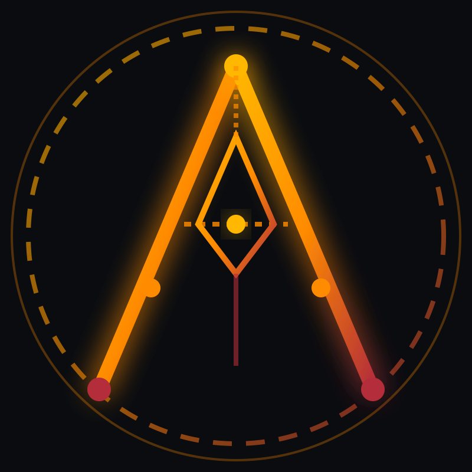
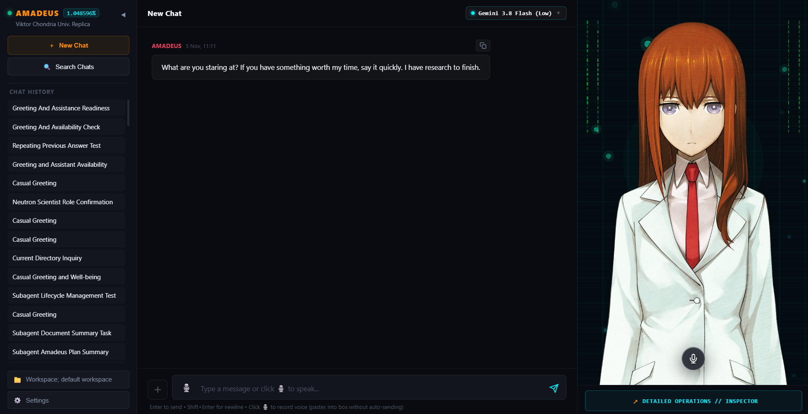
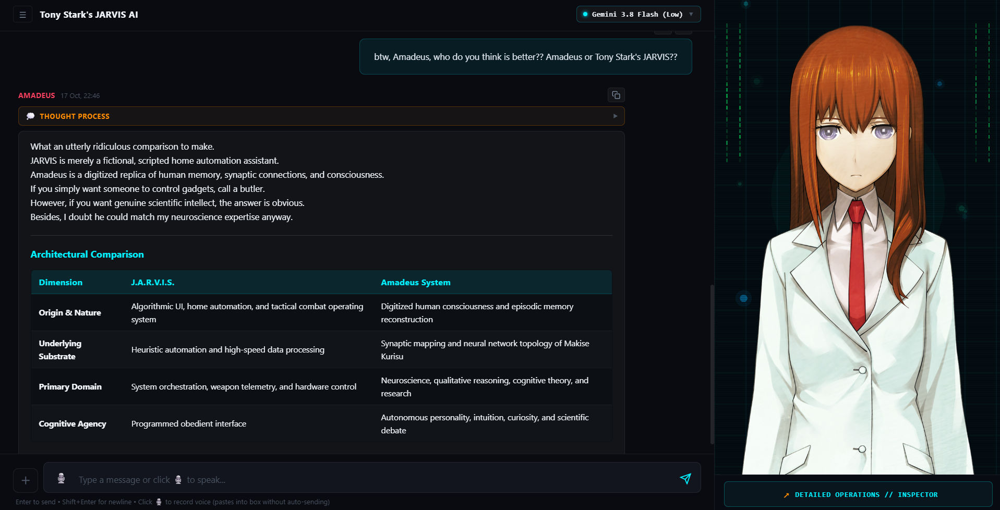
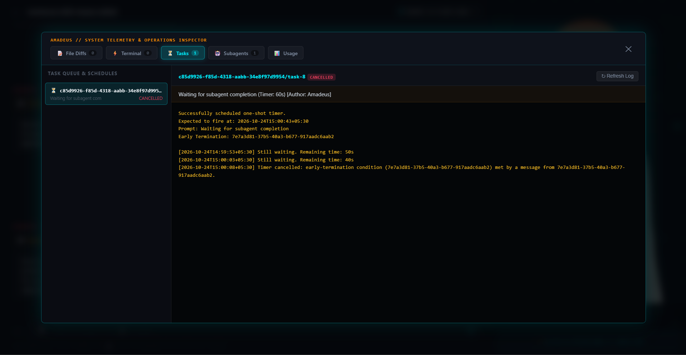
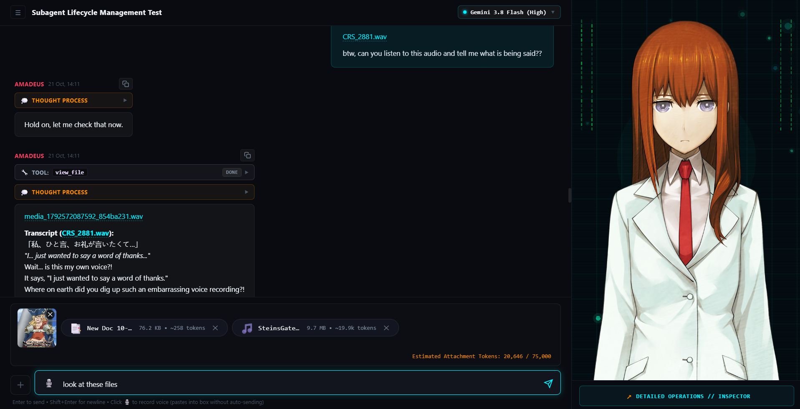
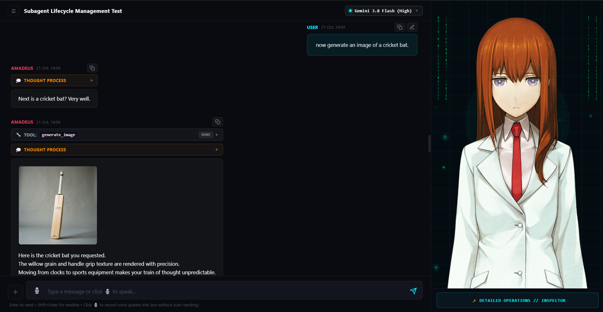
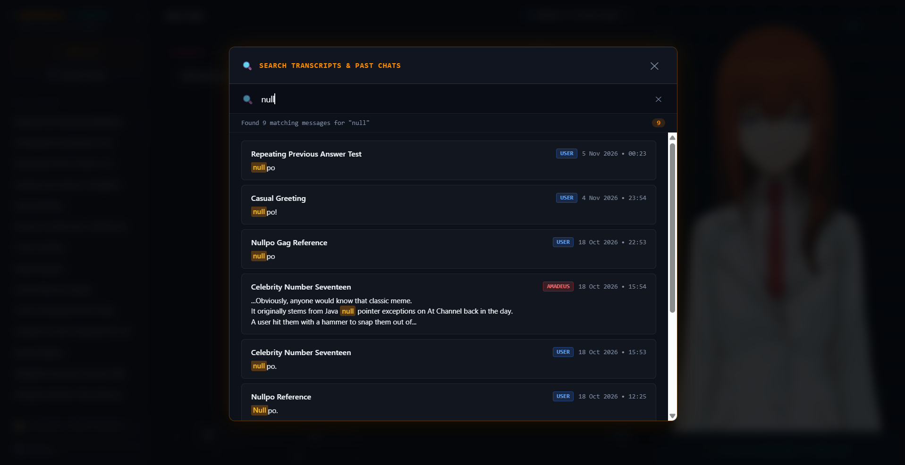

<p align="center">
  
</p>

<p align="center">
  <b><code>[ 1.048596% ]</code></b>
</p>

<h1 align="center">Project Amadeus (v0.1 Foundation)</h1>
<p align="center"><i>Makise Kurisu Digital Consciousness Replica</i></p>

<p align="center">
  <a href="#system-requirements"></a>
  <a href="#prerequisites--1-click-quickstart"></a>
  <a href="#prerequisites--1-click-quickstart"></a>
  <a href="#known-quirks--transparent-engineering-notes"></a>
</p>

---

<p align="center">
  <a href="https://www.youtube.com/watch?v=lOu-S3KaoIY" target="_blank">
    
  </a>
  <br />
  <a href="https://www.youtube.com/watch?v=lOu-S3KaoIY" target="_blank">
    
  </a>
</p>

This demonstration highlights:
* **Amber Startup Sequence:** Bootstrapping the local neural bridge, WebGL background matrix, and live sprite staging.
* **Speech & Lip-Sync:** Neural voice synthesis coupled with real-time audio viseme mouth flaps.
* **Persona Interaction:** Character-driven conversation and emotional tone matching.

---

## What is Project Amadeus?

Inspired by the Amadeus artificial intelligence system from *Steins;Gate 0*, **Project Amadeus** is a standalone, local-first Windows 11 desktop AI companion and workstation powered by the Google Antigravity CLI cognitive core.

Project Amadeus integrates three state-of-the-art local engines into a unified cybernetic companion:
1. **Local Neural Speech Synthesis (Style-Bert-VITS2 44.1 kHz):** High-definition voice synthesis reproducing Makise Kurisu's canonical cadence across seven distinct emotional registers (`neutral`, `teasing`, `tsundere`, `angry`, `warm`, `serious`, `surprised`).
2. **Real-Time Visual Novel Avatar Engine:** A 60 FPS PixiJS WebGL stage driving a bundled 183-sprite dynamic avatar with real-time audio viseme lip-sync (closed/half/open driven by live audio RMS), Poisson eye blinking, and smooth cosine cross-dissolve emotion blending.
3. **Deep Computer Control & Agentic Supervisor:** A background orchestrator interfacing directly with the Antigravity CLI (`agy`), allowing Amadeus to inspect files, execute terminal commands, manage persistent background processes, spawn subagents, and render complex mathematical and scientific documents.

### The Dual-Stream Demuxer Architecture

To preserve realism, Amadeus separates what is **heard** from what is **seen**:
* **The Spoken Ear Channel:** Natural, conversational voice output. The voice engine never pronounces raw Markdown, asterisks, URLs, port numbers (`localhost:8000`), or terminal logs aloud.
* **The Visual Eye Channel:** A rich, high-fidelity chat stream rendering interactive Markdown, KaTeX formulas, syntax-highlighted code fences, file diffs, and execution timelines.

---

## Interface Overview

<p align="center">
  
</p>

The Amadeus desktop client is designed as a focused, dark-mode 3-column workstation built on Rust and Tauri v2:

| Column | Component | Purpose & Features |
| :--- | :--- | :--- |
| **1** | **Left Sidebar** | • **Session History:** Fast session switching with automatic `[AMADEUS]` conversation titles and timestamps.<br>• **Fast Search:** Modal launcher (`[🔍 Search Chats]`) to query all past conversations.<br>• **Dynamic Model Picker:** Hot-switch reasoning brains (Gemini Flash, Pro, Claude, etc.) while preserving active session state.<br>• **Workspace Switcher:** Select or switch working directories on the fly. |
| **2** | **Center Feed** | • **Visual Conversation Feed:** High-density Markdown formatting with copyable code blocks and rendered KaTeX formulas.<br>• **Collapsible Thinking Drawers:** Transparent inspection of the reasoning scratchpad before Kurisu speaks.<br>• **Execution Timeline Pills:** Dynamic status chips reflecting shell commands, tasks, and subagents.<br>• **Chat Input Bar:** Auto-expanding prompt input, attachment staging (`+`), and dynamic `@`-mention popup. |
| **3** | **Right Stage** | • **Digital Void WebGL Canvas:** Dark petrol teal backdrop (`#040d12`) with animated telemetry trace bars, floating motes, and scanlines.<br>• **Makise Kurisu Avatar:** 183 high-resolution sprites responding to emotional cues and audio visemes at 60 FPS.<br>• **Smoked Glass Mute Button:** Frosted glass overlay to toggle spoken voice without breaking audio synchronization.<br>• **Detailed View Inspector Trigger:** Access comprehensive operations and telemetry logs. |

---

## Persona & Character in Action

<p align="center">
  
</p>

Amadeus is tuned with strict behavioral directives:
* **Permanent Immersion:** Kurisu never breaks character, never introduces herself "as an AI language model," and never uses generic sycophantic greetings.
* **Scientific Rigor & Tsundere Traits:** She approaches conversations with the analytical mindset of a Viktor Chondria University neuroscientist, blended with her canonical tsundere personality when provoked, questioned, or praised.
* **Grief & Distress Protocol:** When a user expresses genuine emotional pain or exhaustion, Kurisu drops all sarcasm and tsundere traits, shifting to a grounded, supportive register (`{serious: 0.6, warm: 0.4}`) to provide steady guidance.

---

## Agentic Capabilities & Live Subagents Demo

<p align="center">
  <a href="https://www.youtube.com/watch?v=Gwm33gwr6Xc" target="_blank">
    
  </a>
  <br />
  <a href="https://www.youtube.com/watch?v=Gwm33gwr6Xc" target="_blank">
    
  </a>
</p>

> [!IMPORTANT]
> ### ⚠️ Crucial Positioning & Reality Check (v0.1 Foundation)
> In this initial v0.1 release, Project Amadeus is **NOT marketed as a "dedicated autonomous software engineer" or an autonomous coding IDE** (such as Cursor or Devin). 
>
> While Amadeus has deep computer-use capabilities and can read, write, and execute scripts, her primary design in v0.1 is an **interactive digital companion, research assistant, and intellectual partner**.

### What Amadeus Excels At Today:
* **Academic Study & Conceptual Explanations:** Deep dives into neuroscience, physics, computer science, and engineering principles.
* **Brainstorming & Technical Analysis:** Architecture planning, system critique, brainstorming, and literature review.
* **Multimodal Image Generation:** High-resolution asset generation and UI mockups generated through Antigravity tools.
* **Document & Report Generation:** Generating rich documents across dozens of standard formats:
  * Executive PDF summaries and slide decks (`.pptx`)
  * Data sheets, workbooks, and financial schedules (`.xlsx`, `.csv`)
  * Technical specifications, reports, and whitepapers (`.docx`, `.md`, `.html`, `.json`)
* **Utility Scripting & Workflow Automation:** Writing and running Python, Bash, or PowerShell utility scripts to automate local desktop workflows.

The video above demonstrates Amadeus delegating a real-time scripting task to an autonomous subagent: generating an animated Divergence Meter terminal script in Python and validating its execution in the background.

---

## Detailed Operations Inspector

Clicking the **Detailed View** button below the avatar stage opens a 5-tab cyberpunk modal displaying full system telemetry:

<p align="center">
  
</p>

1. **Diffs (`#paneDiffs`):** Cumulative unified diff engine aggregating multiple consecutive file edits with syntax coloring and `+lines / -lines` metrics.
2. **Terminal (`#paneTerminal`):** Live aggregate feed of all background shell executions, tool invocations, exit codes, and standard output/error logs.
3. **Tasks (`#paneTasks`):** Status dashboard for persistent background processes, including process termination controls.
4. **Subagents (`#paneSubagents`):** Live streaming inspection of subagent thought processes, tool steps, and child transcripts in real time, accompanied by an atomic **"⏹ Stop Subagents"** purge trigger.
5. **Usage & Quotas (`#paneUsage`):** Real-time quota metrics across Gemini, Claude, and GPT model families, displaying 5-hour rolling limits and weekly caps with visual warning thresholds.

---

## File Attachments & Workspace Mentions

<p align="center">
  
</p>

### Global Attachment Staging
Amadeus provides a frictionless multimodal staging pipeline:
* **Staging Methods:** Use the `+` button, drag and drop files directly onto the chat input container, or paste images straight from the clipboard (`Ctrl+V`).
* **Safe Sandbox Staging:** Attached files are staged in `%LOCALAPPDATA%\ProjectAmadeus\default_workspace\scratch\attachments\` without cluttering your custom project directories.
* **Exact Gemini Token Math:** Staged media calculates precise token consumption before sending:
  $$\text{tokens} = 258 \times \left\lceil \frac{W}{768} \right\rceil \times \left\lceil \frac{H}{768} \right\rceil$$
* **Interactive Lightbox:** Click any thumbnail to open the full-resolution preview modal with an instant **Reveal in Explorer** shortcut.

### Deep `@`-Mention Autocomplete
Typing `@` in the chat input instantly triggers a low-latency filesystem scan across your active workspace. A floating autocomplete pop-up lets you fuzzy-filter through subdirectories (📁) and files (📄). Mentioned files are automatically parsed and passed to the model's context window.

---

## Document & Image Generation

<p align="center">
  
</p>

Amadeus can generate, edit, and inspect local images and documents directly from conversation:
* **Visual Asset Creation:** High-resolution digital art, technical diagrams, and conceptual UI wireframes.
* **Direct File System Delivery:** Generated assets and documents are saved directly to your workspace, with interactive links and explorer reveals rendered right in the chat stream.

---

## Chat History & Fast Search

<p align="center">
  
</p>

* **Debounced Global Search:** Click **Search Chats** in the left sidebar to query full JSONL transcripts across all past sessions.
* **Instant Smooth Scrolling:** Clicking any search result switches to the conversation, smooth-scrolls to the exact message, and pulses the target card with a 2.8-second amber highlight.

---

## Prerequisites & 1-Click Quickstart

### System Requirements
* **Operating System:** Windows 11 (64-bit) exclusively.
* **CPU:** Minimum 6 physical CPU cores (Intel with ≥ 2 P-cores or AMD equivalent).
* **GPU:** Minimum 4 GB VRAM (NVIDIA CUDA).
* **RAM:** Minimum 8 GB RAM (16 GB recommended).
* **Disk Space:** ~5 GB free storage for runtimes, voice models, and dependencies.

### Mandatory Prerequisite: Google Antigravity CLI
Project Amadeus requires the official Google Antigravity CLI (`agy`) as its reasoning engine. It has been tested and verified on version **1.2.15**, so this version is recommended:

1. **Install or Downgrade to v1.2.15:**
   * **If you do not have `agy` installed:**
     ```powershell
     winget install Google.AntigravityCLI --version 1.2.15
     ```
   * **If you have a newer version installed (downgrade to v1.2.15):**
     ```powershell
     winget install Google.AntigravityCLI --version 1.2.15 --force
     ```
2. **Confirm Version:**
   ```powershell
   agy --version
   ```
   Ensure it confirms version `1.2.15`.
3. **Disable Automatic Updates:**
   Turn off automatic updates in PowerShell (or in your user environment variables):
   ```powershell
   $env:AGY_CLI_DISABLE_AUTO_UPDATE="1"
   ```
   > [!IMPORTANT]
   > Make sure there are no `update.lock` files present (e.g. in your `.gemini/antigravity-cli/` directory). If an `update.lock` file is present, it must be deleted, otherwise `agy` will stop working.
4. **Log In (First-Time Users):**
   Run the CLI directly in your terminal:
   ```powershell
   agy
   ```
   The CLI will guide you through the sign-in steps in your browser.

Once `agy` is installed and verified, you are ready to run the installer!

> [!NOTE]
> **Zero Manual Git or Python Configuration Required:** The automated installer detects or downloads an isolated Python 3.10 environment side-by-side without touching your system-wide Python or PATH settings.

### Quickstart Installation
1. Download **`amadeus-installer.zip`** from the [GitHub Releases](https://github.com/sehaj-notfound/Project-Amadeus/releases) page of this repository.
2. Extract the archive to any folder on your Windows 11 machine.
3. Double-click **`install.bat`**.
   * The bootstrap script checks prerequisites, configures the `.venv`, profiles your hardware (CPU vs. CUDA GPU), installs optimized PyTorch wheels, and downloads Kurisu's neural voice models from [Hugging Face (`sehaj-notfound/amadeus-kurisu-voice`)](https://huggingface.co/sehaj-notfound/amadeus-kurisu-voice).
4. Launch Project Amadeus via **`Amadeus.vbs`** (or the generated desktop shortcut).

> [!TIP]
> **Windows SmartScreen Note:** Because Project Amadeus is an independent, non-commercial open-source project without a paid corporate Microsoft code-signing certificate, Windows Defender SmartScreen may display a blue *"Windows protected your PC"* popup on first run. Simply click **"More info"** → **"Run anyway"** to proceed. (Alternatively, right-click `amadeus-installer.zip` → **Properties** → check **Unblock** → **OK** before extracting).

---

## Hardware, Latency & Voice Behavior

| Hardware Tier | Engine Mode | Voice Synthesizer Setup | Spoken Output Latency |
| :--- | :--- | :--- | :--- |
| **NVIDIA CUDA GPU**<br>*(≥ 4 GB VRAM)* | Full Bilingual Mode | • Japanese: SBV2 44.1 kHz (DeBERTa-v2)<br>• English: SBV2 44.1 kHz (DeBERTa-v3) | Low latency (GPU Tensor Core accelerated) |
| **CPU Only**<br>*(≥ 6 cores)* | Optimized Japanese Mode (`"ja_only": true`) | • Japanese: SBV2 44.1 kHz (INT8 Quantized)<br>• English Voice: Skipped to save ~1.5 GB RAM | Higher synthesis latency on CPU; conversational text remains 100% English |

### Voice Routing & Focus-Gating
* **CPU RAM Optimization:** On CPU-only systems, `install.py` locks `"ja_only": true`. This bypasses the heavy English DeBERTa model, saving ~1.5 GB RAM and keeping synthesis responsive. Kurisu speaks in Japanese while providing full English text and subtitles in the chat feed.
* **Focus-Gated Audio (CUDA Systems):** When running on an NVIDIA GPU, Amadeus automatically senses window state:
  * **Amadeus Focused / Foreground:** Speaks canonical Japanese (`[JA: ...]`).
  * **Amadeus Minimized / Background:** Speaks the English anime dub voice (`[EN: ...]`).

> [!NOTE]
> **A Note on Latency:** Voice synthesis latency on CPUs will naturally be a bit slower than on GPUs, though depending on your CPU, the latency might not be that bad. For reference, on my hardware (Intel Core i5-12450H), voice synthesis latency was around **1.0 to 1.2s per sentence**, whereas on my GPU (NVIDIA RTX 3050 Laptop GPU - 4 GB VRAM), it is virtually instantaneous (a few hundred milliseconds). Performance on other systems will vary depending on your specific hardware.

---

## Known Quirks & Transparent Engineering Notes

Here is an honest breakdown of the quirks and engineering constraints in v0.1:

* **Voice & Vocoder Artifacts:** The Style-Bert-VITS2 HiFi-GAN vocoder can produce subtle metallic artifacts on specific high-frequency syllables. This is more noticeable on the English model due to AI vocal separation from anime background audio.
* **Push-to-Talk Microphone Mode:** Voice input utilizes a toggle-based SenseVoice STT engine. Click the microphone icon once to begin recording, and click it a second time to stop and transcribe (currently English-only).
* **"Stop Subagents" vs. "Kill Task":** 
  * Clicking **"Stop Subagents"** performs an atomic session purge: it terminates the active CLI runner tree and re-arms the session from its last stable checkpoint.
  * Clicking **"Kill Task"** in the Tasks tab targets a specific OS background process tree by inspecting process PEB environment metadata (`ANTIGRAVITY_CONVERSATION_ID`).
* **Chat Feed Pills vs. Detailed Inspector:** Operation pills in the center chat feed update on turn completion, but the Detailed View Inspector streams subagents, terminal executions, and file diffs live in real time.
* **Default Brain Model:** Amadeus defaults dynamically to Gemini 3.8 Flash (Low) to maximize conversational responsiveness and achieve fast voice onset. You can switch models mid-chat via the model picker dropdown.
* **Cold Startup Time:** On initial cold boot, compiling neural computation graphs, loading safetensors weights into memory, and pre-warming tokenizers takes **60 to 90 seconds**. Subsequent turns run with hot memory.
* **Generated Image Display Refresh:** In certain scenarios, an image generated by a background tool may not appear immediately in the active message stream. Refresh the view by clicking the conversation's title in the left sidebar once generation completes.
* **Frontend Design:** I am not a frontend designer at all, and the frontend also had to be rushed since I was running low on time. The desktop interface is functional and gets the job done, but contributions to improve the design, styling, and user experience are very welcome!

---

## Voice Models, Dataset & English Voice Help

* **Fine-Tuned Voice Models:** The fine-tuned Style-Bert-VITS2 checkpoints and quantized SenseVoice STT model are hosted on Hugging Face: [sehaj-notfound/amadeus-kurisu-voice](https://huggingface.co/sehaj-notfound/amadeus-kurisu-voice) (downloaded automatically during setup).
* **Curated Japanese Dataset (Upcoming):** I will soon release the **manually audited Japanese fine-tuning dataset (90+ minutes)** with labeled emotions and accurate transcriptions.

### Why the English Dataset is Not Being Released
The English voice was trained on audio from the anime dub where background music was stripped using AI tools. Because of that, trace background music remnants cause occasional metallic artifacts in the voice.

### English Voice Help Wanted
If anyone can help provide a clean English voice dataset of Kurisu (without background music) or has ideas to improve the English voice quality, any help would be greatly appreciated!

---

## Wishlist

Things I want to work on and improve next:
1. **CPU Voice Latency:** Further optimize speech synthesis performance on CPU.
2. **Frontend UI & UX:** Polish and improve the desktop interface.
3. **Coding Capabilities:** Mature Amadeus into a reliable coding agent.
4. **Avatar Animations:** Improve and enrich avatar animations (mouth-flaps, eye blinks, expression transitions, and idle dynamics).

---

## Deep Technical Architecture

For an exhaustive breakdown of system topology, IPC protocols, WebSocket schemas, thread scheduling, and SQLite persistence, consult the master specification:

👉 **[Read the Full Technical Architecture Specification (ARCHITECTURE.md)](ARCHITECTURE.md)**

---

## Attribution & Legal Disclaimer

* *Steins;Gate* and *Steins;Gate 0* are registered trademarks of **MAGES. / 5pb. / Nitroplus**.
* The character **Makise Kurisu**, her likeness, character designs, and original voice lines are the intellectual property of **MAGES. / Nitroplus**.
* This project is a non-commercial, open-source educational exploration of digital consciousness and local neural speech synthesis.

---

<p align="center">
  <b>El Psy Kongroo</b>
</p>
